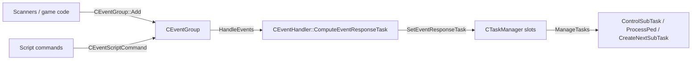

# Ped AI tasks

How peds decide what to *do*: the task tree, the task manager, the per-frame loop, and the conventions used when
reversing a `CTask*` class. For the general workflow see [../ReversingGuide.md](../ReversingGuide.md); for how hooks
work see [../Architecture.md](../Architecture.md) and [../HookRegistration.md](../HookRegistration.md). Events, which
produce most tasks, are described in [Events.md](Events.md) (source: `source/game_sa/Events/`).

All paths are relative to the repo root. Addresses are the ones written in the repo (`RH_*Install` or `// 0xADDR`).

---

## 1. Overview

A ped's behaviour is a set of **task trees**. Each tree is a chain of *complex* tasks that ends in exactly one *simple*
task. Complex tasks only make decisions (which sub-task to run next). The simple task at the bottom does the work every
frame (play an anim, move the ped, ...).

```
CPed ──> CPedIntelligence (pooled, source/game_sa/PedIntelligence.h)
            ├─ CEventGroup     m_eventGroup     events waiting to be handled
            ├─ CEventHandler   m_eventHandler   turns the top event into tasks
            └─ CTaskManager    m_TaskMgr        owns the task trees
                 ├─ m_aPrimaryTasks[5]    only the FIRST non-null slot runs (priority order)
                 │    [0] PHYSICAL_RESPONSE      e.g. hit/fall responses
                 │    [1] EVENT_RESPONSE_TEMP    collision / walk-into... responses
                 │    [2] EVENT_RESPONSE_NONTEMP other event responses
                 │    [3] PRIMARY                script / group orders
                 │    [4] DEFAULT                wander, stand still, player on foot, car drive
                 └─ m_aSecondaryTasks[6]  ALL run every frame
                      ATTACK, DUCK, SAY, FACIAL_COMPLEX, PARTIAL_ANIM, IK

One tree (example):
  CTaskComplexWander ──m_pSubTask──> CTaskComplexX ──m_pSubTask──> CTaskSimpleGoToPoint   (leaf: ProcessPed)
        ^                                 │ m_Parent
        └─────────────────────────────────┘
```



Slot enums: `ePrimaryTasks` and `eSecondaryTask` in `source/game_sa/Tasks/TaskManager.h:15-38`.

---

## 2. Key classes and responsibilities

| Class / file | Role |
|---|---|
| `CTask` (`source/game_sa/Tasks/Task.h`) | Abstract base. 8 bytes: vtable + `m_Parent` (a `CTaskComplex*`). Pooled `operator new/delete` (`Task.cpp:12-19`, `0x61A5A0` / `0x61A5B0`). `IsTaskPtr` checks pool validity |
| `CTaskSimple` (`Tasks/TaskSimple.h`) | Leaf task. `ProcessPed` returns `true` when finished. `SetPedPosition` is an optional post-collision hook. Size `0x8` |
| `CTaskComplex` (`Tasks/TaskComplex.h`) | Decision task. Owns `m_pSubTask` (deleted in its destructor). `CreateFirstSubTask` / `CreateNextSubTask` / `ControlSubTask`. Size `0xC` |
| `CTaskManager` (`Tasks/TaskManager.h/.cpp`) | 5 primary and 6 secondary root slots plus `m_pPed`. Size `0x30`. Builds, runs, advances and frees trees |
| `CPedIntelligence` (`source/game_sa/PedIntelligence.cpp`) | Holds `m_TaskMgr` (`PedIntelligence.h:41`). `Process` (`0x608260`) is the per-ped AI tick |
| `CEventHandler` (`source/game_sa/Events/EventHandler.cpp`) | `HandleEvents` picks the top event, `ComputeEventResponseTask` (`0x4C3870`) builds up to 5 response tasks, `SetEventResponseTask` (`0x4BC600`) puts them in slots |
| `CTaskPool` (`source/game_sa/Pools/TaskPool.h`) | `CPool<CTask, CTaskSimpleSlideToCoord>`: slot size is `sizeof(CTaskSimpleSlideToCoord)` = `0x80`. Created with 500 slots (`source/game_sa/Pools.cpp:81`), pointer at `0xB744A8` |
| `CTaskComplexSequence` (`Tasks/TaskComplexSequence.h`) | Up to 8 tasks run in order, optional repeat. Size `0x40` |
| `CTaskSequences` (`Tasks/TaskSequences.h`) | 64 static script sequences (`ms_taskSequence` at `0xC178F0`). Script tasks given to ped handle `-1` go into the active sequence |
| `CTaskComplexUseSequence` (`Tasks/TaskComplexUseSequence.h`) | Runs one of the `CTaskSequences` entries by index (cloning each step) |
| `CPedScriptedTaskRecord` (`Tasks/PedScriptedTaskRecord.h`) | Tracks script-given tasks so the script can query their status (`GetStatus`) |
| `CScriptedBrainTaskStore` (`Tasks/ScriptedBrainTaskStore.h`) | Holds tasks for peds driven by script brains (attractor scripts) |
| `CTaskTimer` (`Tasks/TaskTimer.h`) | Start time + interval + started/stopped flags. Used inside many tasks |
| `CTaskCategories` (`Tasks/TaskCategories.h`) | Classifies tasks (flee / follow / kill ped) |
| `CTaskAllocator*` (`Tasks/Allocators/`) | **Not tasks.** Group-level objects (own vtable, `GetType()` returns `eTaskAllocatorType`) that hand tasks to members of a `CPedGroup` |
| `eTaskType` (`source/game_sa/Enums/eTaskType.h`) | All task ids, grouped in hundreds (player 0, emergency 100, `TASK_NONE` = 200, ...). `EnumToString` at line 578 |
| Task implementations | `source/game_sa/Tasks/TaskTypes/` (about 300 headers, including `Interior/` and `SeekEntity/`) |

---

## 3. Per-frame flow

Entry points in `CPedIntelligence` (`source/game_sa/PedIntelligence.cpp`):

| Function | Address | What it does for tasks |
|---|---|---|
| `ProcessFirst` (line 919) | `0x6073A0` | Stuck checker and collision scanner add events. Clears `bMoveAnimSpeedHasBeenSetByTask` |
| `Process` (line 950) | `0x608260` | Vehicle/ped/event scanners, then **`m_eventHandler.HandleEvents()`**, then **`m_TaskMgr.ManageTasks()`**, then relationship recording and look-at |
| `ProcessAfterProcCol` (line 539) | `0x6018F0` | Calls `SetPedPosition` on the simplest active task; if that returns false, on the leaf of `TASK_PRIMARY_DEFAULT`. Called from `CWorld` (`World.cpp:2343`) |
| `ProcessAfterPreRender` (line 564) | `0x6019B0` | `SetPedPosition` on the PARTIAL_ANIM and ATTACK secondaries (hold entity, use gun). Called from `CWorld::ProcessPedsAfterPreRender` (`World.cpp:252`) |

The per-frame caller of `ProcessFirst`/`Process` is not in reversed code: `CPed::ProcessControl` (`0x5E8CD0`) is still
a `plugin::CallMethod` stub (`source/game_sa/Entity/Ped/Ped.cpp:3692`). Check the IDB when you need the exact order.
`CPopulation` also calls `ProcessEventHandler()` + `Process()` directly on a new attractor ped
(`source/game_sa/Population.cpp:1439-1440`).

### `CTaskManager::ManageTasks` (`TaskManager.cpp:253`, `0x681C10`)

1. Take the **first non-null primary slot** (`GetActiveTaskIndex`). Lower-priority slots are left alone. They keep
   their trees but are not processed.
2. If that tree does not end in a simple task, delete it and return.
3. Up to **10 iterations** of `ProcessTaskTree(root)`:
   - `ParentsControlChildren(root)` (`0x681A80`): walk down the tree calling `ControlSubTask`. At the first complex
     task that returns a **different** sub-task, call `oldSubTask->MakeAbortable(ped)` (URGENT, return value ignored),
     `SetSubTask(new)` (this deletes the old sub-tree), `AddSubTasks(new)`, and stop walking.
   - If the leaf is still complex (building the sub-tasks failed), try `SetNextSubTask(leaf->GetParent())`. If it is
     still complex, the tree is finished.
   - `leaf->ProcessPed(ped)`. `false` means still running: stop.
   - `true` means the leaf is done: `SetNextSubTask(leaf->GetParent())`. If the root has no sub-task left, the tree is
     finished and the root is deleted. Otherwise loop again, so a new leaf can run in the same frame.
4. Every non-null **secondary** slot gets the same processing (no 10-iteration limit). A finished secondary tree is
   deleted.

### Building and advancing trees

- `AddSubTasks(task)` (`0x681A30`, line 193): while `task` is complex, `sub = CreateFirstSubTask(ped)`, then
  `SetSubTask(sub)` and go down. If it returns `nullptr`, the task counts as finished: call
  `SetNextSubTask(parent)`.
- `SetNextSubTask(task)` (`0x681920`, line 155): walk **up** from `task`. The first ancestor whose
  `CreateNextSubTask` returns non-null gets it as its sub-task (then `AddSubTasks`). Every ancestor that returns null
  gets `SetSubTask(nullptr)`, which deletes its sub-tree.
- `ChangeTaskInSlot` (line 352), used by `SetTask` (`0x681AF0`) and `SetTaskSecondary` (`0x681B60`): delete the old
  root, store the new one, `AddSubTasks`, and delete it **at once** if the tree does not end in a simple task.

---

## 4. Lifecycle of a task

```
new CTaskX(args)                      operator new -> GetTaskPool()->New()   (Task.cpp:12)
   │
   ├─ given to a slot: SetTask / SetTaskSecondary / CEventHandler response / script event
   │      └─ AddSubTasks: CreateFirstSubTask ... down to a simple leaf
   │
   ├─ every frame (only if in the active primary slot, or a secondary slot):
   │      complex: ControlSubTask   -> same sub-task | new sub-task | (see notes)
   │      simple : ProcessPed       -> false (running) | true (finished)
   │      finished leaf -> parent->CreateNextSubTask  (null = parent finished too, go up)
   │
   ├─ interrupted: MakeAbortable(ped, priority, event)
   │      true  = "I stopped, you may delete me now"
   │      false = "I will finish soon" (task should arrange to return true from ProcessPed later)
   │
   └─ delete: by the parent (SetSubTask / ~CTaskComplex), by the slot (ChangeTaskInSlot, Flush, ManageTasks)
          operator delete -> GetTaskPool()->Delete()   (Task.cpp:17)
```

### Creation sources

- **Events**: `CEventHandler::HandleEvents` (`EventHandler.cpp:319`). If the top event takes priority over the
  current one, it asks the active task to abort (`MakeAbortable(..., ABORT_PRIORITY_URGENT, event)`). If the task
  refuses, it re-asks with `ABORT_PRIORITY_LEISURE` and keeps the event for later. Otherwise
  `ComputeEventResponseTask` (`line 2853`) dispatches to one `Compute*Response`, which fills
  `m_PhysicalResponseTask`, `m_EventResponseTask`, `m_AttackTask`, `m_SayTask` and `m_PartialAnimTask`.
  `SetEventResponseTask` (`line 440`) stores them in PHYSICAL_RESPONSE, EVENT_RESPONSE_TEMP or _NONTEMP (by
  `IsTemporaryEvent`, `0x4BC370`), and in the ATTACK / SAY / PARTIAL_ANIM secondaries.
- **Scripts**: `CRunningScript::GivePedScriptedTask` (`source/game_sa/Scripts/RunningScript.cpp:236`) wraps the task
  in a `CEventScriptCommand` (`TASK_PRIMARY_PRIMARY`), or adds it to the active sequence when the handle is `-1`.
  `CEventHandler::ComputeScriptCommandResponse` (`EventHandler.cpp:2151`) then clones it into the PRIMARY or DEFAULT
  slot.
- **Groups**: `CPedIntelligence::AddTaskPrimaryMaybeInGroup` (`0x600E20`) routes to
  `CPedGroupIntelligence::SetScriptCommandTask` for group members. Group intelligence (`PedGroupIntelligence.h`)
  takes `const CTask&` and clones it into its `CPedTaskPair`s.
- **Defaults**: `CPedIntelligence::FlushImmediately(true)` (`0x601640`, line 455) puts back `CTaskSimplePlayerOnFoot`,
  a wander task or `CTaskSimpleStandStill` in `TASK_PRIMARY_DEFAULT`. Ped creation does the same
  (`Population.cpp:1432`, `Ped.cpp:302`, `CarAI.cpp:63`).

### Abort priorities (`eAbortPriority`, `Task.h:10`)

| Value | Meaning in practice |
|---|---|
| `ABORT_PRIORITY_LEISURE` (0) | "Please finish when convenient." Tasks usually start blending out and return `false` |
| `ABORT_PRIORITY_URGENT` (1) | Default argument. Abort now if you safely can |
| `ABORT_PRIORITY_IMMEDIATE` (2) | Must stop. Used by `CTaskManager::FlushImmediately` (`0x6818A0`), which deletes every root that returns `true` |

`CTaskComplex::MakeAbortable` simply forwards to `m_pSubTask` (`TaskComplex.h:22-24`). Most complex tasks keep this
or forward after doing their own cleanup.

### Destruction

`CTaskComplex::~CTaskComplex` deletes `m_pSubTask`, so deleting a root frees the whole tree. A destructor must undo
everything the task registered: entity refs (`CEntity::SafeCleanUpRef`), anim callbacks (reset to
`CDefaultAnimCallback::DefaultAnimCB`), anim block refs, IK chains, and so on.

---

## 5. Virtual interface (vtable order = declaration order)

MSVC puts virtuals in declaration order, so the slot index below is the index in the GTA vtable. The `nVirtFns`
argument of `RH_ScopedVirtualClass` is the total count.

| Slot | `CTask` (`Task.h`) | Notes |
|---|---|---|
| 0 | `~CTask()` (line 39) | scalar deleting destructor, `0x61A660` |
| 1 | `CTask* Clone() const = 0` (42) | deep copy, used by sequences, scripts, group code |
| 2 | `CTask* GetSubTask() const = 0` (45) | `final` in Simple (null) and Complex (`m_pSubTask`) |
| 3 | `bool IsSimple() const = 0` (48) | `final` in both bases |
| 4 | `eTaskType GetTaskType() const = 0` (54) | used by `notsa::isa/cast` through `classof` (line 89) |
| 5 | `void StopTimer(const CEvent*)` (57) | default no-op `0x421180`. `CTaskManager::StopTimers` calls it on primary roots |
| 6 | `bool MakeAbortable(CPed*, eAbortPriority = URGENT, const CEvent* = nullptr) = 0` (68) | |

| Slot | `CTaskSimple` (`TaskSimple.h`) | `CTaskComplex` (`TaskComplex.h`) |
|---|---|---|
| 7 | `bool ProcessPed(CPed*) = 0` (28) | `void SetSubTask(CTask*) final` (28), virtual in GTA, keep it virtual |
| 8 | `bool SetPedPosition(CPed*)` (37), default `false` | `CTask* CreateNextSubTask(CPed*) = 0` (45) |
| 9 | (end: **9** entries) | `CTask* CreateFirstSubTask(CPed*) = 0` (54) |
| 10 | | `CTask* ControlSubTask(CPed*) = 0` (67) (end: **11** entries) |

Derived tasks that add virtuals append them after these, which gives a larger count. Examples:
`CTaskSimpleHitWall::IsInterruptable` (10), `CTaskSimpleIKChain::CreateIKChain` (10),
`CTaskComplexEnterCar::CreateNextSubTask_AfterSimpleCarAlign` (12), `CTaskComplexUseSwatRope` (13). Counts used in
`source/game_sa/Tasks/`: 129 classes use 11, 92 use 9, 18 use 10, 8 use 14, 4 use 15, 3 use 12, 1 uses 13.

Return-value contracts (from the doc comments in the headers and from `TaskManager.cpp`):

- `ProcessPed`: `true` = finished, `false` = keep running.
- `CreateFirstSubTask`: the first sub-task, or `nullptr` = this task is already finished.
- `CreateNextSubTask`: called after the sub-task finished. `nullptr` = this task is finished.
- `ControlSubTask`: return `m_pSubTask` to keep it, or a **new** task to replace it. The manager calls
  `MakeAbortable` on the old one but ignores the result and deletes it anyway, so well-behaved tasks check first:

  ```cpp
  // source/game_sa/Tasks/TaskTypes/TaskComplexArrestPed.cpp:122
  if (m_pSubTask->MakeAbortable(ped)) { return CreateSubTask(taskType, ped); }
  return m_pSubTask;
  ```

---

## 6. Conventions when reversing a task

### Header

- `class NOTSA_EXPORT_VTABLE CTaskXxx : public CTaskSimple / CTaskComplex`. `NOTSA_EXPORT_VTABLE` is
  `__declspec(dllexport)` (`source/Base.h:137`). It is **required** for `RH_ScopedVirtualClass`: our vtable is found
  through the exported symbol `??_7CTaskXxx@@6B@` (`source/reversiblehooks/VMTInfo.cpp:20-29`).
- `static constexpr auto Type = TASK_...;` and `GetTaskType() const override { return Type; }`. `Type` is what
  `notsa::isa/cast`, `CTaskManager::Find<T>()` and `CTask::CloneIfIs<T>` use.
- `Clone() const override`: either `new CTaskXxx{ *this }` with a hand-written (NOTSA) copy constructor, or
  `new CTaskXxx(m_a, m_b, ...)` mirroring the original. Only copy the **construction parameters**, not runtime state,
  unless the original does.
- Field offsets as comments, then `VALIDATE_SIZE(CTaskXxx, 0x..)`. The size must be **at most `0x80`**, the task pool
  slot size.
- Hook wrappers `Constructor(...)` / `Destructor()` as private members that call the real constructor/destructor and
  return `this`.
- `static void InjectHooks();`, plus `friend void InjectHooksMain();` if `InjectHooks` is private. Add the call to
  `source/InjectHooksMain.cpp` (it has about 340 `Task...::InjectHooks()` calls).

### `InjectHooks`

```cpp
RH_ScopedVirtualClass(CTaskXxx, 0x<GTA vtable>, <9 | 11 | more>);
RH_ScopedCategory("Tasks/TaskTypes");
RH_ScopedInstall(Constructor, 0x...);
RH_ScopedInstall(Destructor, 0x...);                 // non-virtual wrapper
RH_ScopedVMTInstall(Clone, 0x...);                   // virtuals: patched in GTA's vtable
RH_ScopedVMTInstall(GetTaskType, 0x...);
RH_ScopedVMTInstall(MakeAbortable, 0x...);
RH_ScopedVMTInstall(ProcessPed, 0x...);              // or CreateFirst/CreateNext/ControlSubTask
RH_ScopedInstall(CreateSubTask, 0x...);              // usual non-virtual helper of complex tasks
RH_ScopedVMTInstall(ControlSubTask, 0x..., { .Reversed = false }); // still plugin::CallMethod
```

- `{ .Overrides = false }` on a VMT install is needed when **our** class does not override the method but GTA has
  its own copy for this class (`source/reversiblehooks/RHManager.h:79-86`). Examples: `MakeAbortable` in
  `TaskComplexSequence.cpp:12`, `TaskComplexWalkAlongsidePed.cpp:21`.
- Overloads use `RH_ScopedVMTOverloadedInstall(fn, "suffix", addr, Signature)` (see `TaskComplexSequence.cpp:13`).
- Small inline `Clone`/`GetTaskType` are often **not hooked**, only marked `// 0xADDR`. That is why the coverage tool
  lists many otherwise finished task classes with 1-2 "known" or "missing" functions.

### Typical helpers and idioms

- `CTask* CreateSubTask(eTaskType, CPed*)`: a switch that builds the sub-task for a given type. Found in 127 files
  under `source/game_sa/Tasks/`. `CreateFirstSubTask`, `CreateNextSubTask` and `ControlSubTask` then only choose a
  type.
- Anim-driven simple tasks: `m_bIsFinished` + `CAnimBlendAssociation* m_pAnim` + `static void FinishAnimCB(
  CAnimBlendAssociation*, void* data)` registered with `SetFinishCallback(FinishAnimCB, this)`.
- Entity references: `CEntity::SafeRegisterRef(m_veh)` in the constructor (copy constructor too), and
  `SafeCleanUpRef` in the destructor.
- `CTaskTimer` for timeouts (`Start`, `Reset`, `IsOutOfTime`).
- Lookups from other code: `ped->GetTaskManager().Find<CTaskXxx>()`, `GetActiveTaskAs<T>()`,
  `GetSimplestActiveTaskAs<T>()`, `notsa::dyn_cast_if_present<T>(task)`.

### Template 1: complex task (`CTaskComplexLeaveBoat`, fully reversed)

`source/game_sa/Tasks/TaskTypes/TaskComplexLeaveBoat.h/.cpp` (condensed):

```cpp
// VMT: 0x86e854 | Size: 11
class NOTSA_EXPORT_VTABLE CTaskComplexLeaveBoat : public CTaskComplex {
public:
    CVehicle* m_veh = {};         // 0xC
    uint32    m_delayTimeMs = {}; // 0x10

    static void InjectHooks();
    constexpr static auto Type = eTaskType::TASK_COMPLEX_LEAVE_BOAT;

    CTaskComplexLeaveBoat(CVehicle* vehicle, uint32 delay);
    CTaskComplexLeaveBoat(const CTaskComplexLeaveBoat&); // NOTSA, delegates to the ctor above (re-registers ref)
    ~CTaskComplexLeaveBoat();                            // SafeCleanUpRef(m_veh)

    CTask* CreateSubTask(eTaskType taskType);
    CTask*    Clone() const override { return new CTaskComplexLeaveBoat{ *this }; }
    eTaskType GetTaskType() const override { return Type; }
    CTask*    CreateNextSubTask(CPed* ped) override;  // return nullptr
    CTask*    CreateFirstSubTask(CPed* ped) override; // return CreateSubTask(TASK_SIMPLE_CAR_SET_PED_OUT)
    CTask*    ControlSubTask(CPed* ped) override;     // return m_pSubTask
private:
    CTaskComplexLeaveBoat* Constructor(CVehicle* v, uint32 d) { this->CTaskComplexLeaveBoat::CTaskComplexLeaveBoat(v, d); return this; } // 0x63BB60
    CTaskComplexLeaveBoat* Destructor() { this->CTaskComplexLeaveBoat::~CTaskComplexLeaveBoat(); return this; }                           // 0x642250
};

void CTaskComplexLeaveBoat::InjectHooks() {
    RH_ScopedVirtualClass(CTaskComplexLeaveBoat, 0x86e854, 11);
    RH_ScopedCategory("Tasks/TaskTypes");
    RH_ScopedInstall(Constructor, 0x63BB60);
    RH_ScopedInstall(Destructor, 0x642250);
    RH_ScopedInstall(CreateSubTask, 0x63BC50);
    RH_ScopedVMTInstall(Clone, 0x63DA60);
    RH_ScopedVMTInstall(GetTaskType, 0x63BBC0);
    RH_ScopedVMTInstall(CreateNextSubTask, 0x63BC30);
    RH_ScopedVMTInstall(CreateFirstSubTask, 0x642270);
    RH_ScopedVMTInstall(ControlSubTask, 0x63BC40);
}
```

### Template 2: simple task (`CTaskSimpleStandStill`)

`source/game_sa/Tasks/TaskTypes/TaskSimpleStandStill.h/.cpp` (condensed):

```cpp
class NOTSA_EXPORT_VTABLE CTaskSimpleStandStill : public CTaskSimple {
public:
    int32      m_nTime;
    CTaskTimer m_timer;
    bool       m_bLooped;
    bool       m_bUseAnimIdleStance;
    float      m_fBlendData;

    static constexpr auto Type = TASK_SIMPLE_STAND_STILL;
    CTaskSimpleStandStill(int32 nTime = 0, bool Looped = false, bool bUseAnimIdleStance = false, float fBlendData = 8.0f);

    eTaskType GetTaskType() const override { return Type; }
    CTask* Clone() const override { return new CTaskSimpleStandStill(m_nTime, m_bLooped, m_bUseAnimIdleStance, m_fBlendData); } // 0x635CF0
    bool MakeAbortable(CPed* ped, eAbortPriority priority = ABORT_PRIORITY_URGENT, const CEvent* event = nullptr) override;
    bool ProcessPed(CPed* ped) override;
private:
    friend void InjectHooksMain();
    static void InjectHooks();
    CTaskSimpleStandStill* Constructor(int32 t, bool l, bool i, float b) { this->CTaskSimpleStandStill::CTaskSimpleStandStill(t, l, i, b); return this; }
};
VALIDATE_SIZE(CTaskSimpleStandStill, 0x20);

void CTaskSimpleStandStill::InjectHooks() {
    RH_ScopedVirtualClass(CTaskSimpleStandStill, 0x86DD2C, 9);
    RH_ScopedCategory("Tasks/TaskTypes");
    RH_ScopedInstall(Constructor, 0x62F310);
    RH_ScopedVMTInstall(MakeAbortable, 0x4B8690);
    RH_ScopedVMTInstall(ProcessPed, 0x62F370);
}
```

### Template 3: anim callback pattern (`CTaskSimpleHitHead`, `TaskSimpleHitHead.cpp`)

```cpp
CTaskSimpleHitHead::~CTaskSimpleHitHead() {               // 0x653090
    if (m_pAnim) m_pAnim->SetFinishCallback(CDefaultAnimCallback::DefaultAnimCB, nullptr); // never leave `this` dangling
}
void CTaskSimpleHitHead::FinishAnimCB(CAnimBlendAssociation*, void* data) { // 0x653150
    auto task = reinterpret_cast<CTaskSimpleHitHead*>(data);
    task->m_pAnim = nullptr; task->m_bIsFinished = true;
}
bool CTaskSimpleHitHead::MakeAbortable(CPed*, eAbortPriority priority, const CEvent*) { // 0x6530F0
    if (priority == ABORT_PRIORITY_URGENT || priority == ABORT_PRIORITY_IMMEDIATE) {
        if (m_pAnim) { m_pAnim->m_BlendDelta = -4.0F; m_pAnim->SetFinishCallback(CDefaultAnimCallback::DefaultAnimCB, nullptr); m_pAnim = nullptr; }
        m_bIsFinished = true;
        return true;
    }
    if (m_pAnim) m_pAnim->m_BlendDelta = -4.0F; // LEISURE: blend out, finish via callback
    return false;
}
bool CTaskSimpleHitHead::ProcessPed(CPed* ped) {           // 0x657A10
    if (m_bIsFinished) return true;
    if (!m_pAnim) {
        m_pAnim = CAnimManager::BlendAnimation(ped->GetRpClump(), ANIM_GROUP_DEFAULT, ANIM_ID_HIT_WALL, 8.0F);
        m_pAnim->SetFinishCallback(FinishAnimCB, this);
    }
    return m_bIsFinished;
}
```

---

## 7. Gotchas

- **Only one primary tree runs.** A task in `TASK_PRIMARY_DEFAULT` is not processed while any higher slot is
  occupied. Its state is frozen, not reset. Secondaries all run, every frame.
- **A tree must end in a simple task.** `ChangeTaskInSlot` and `ManageTasks` delete roots whose leaf is complex. A
  complex task whose `CreateFirstSubTask` returns `nullptr` is treated as finished right away.
- **`ControlSubTask` returning a new task deletes the old one**, whether its `MakeAbortable` agreed or not
  (`TaskManager.cpp:221-225`). Mirror the original's `MakeAbortable` check exactly.
- **`CTaskComplex::MakeAbortable` does not null-check `m_pSubTask`** (`TaskComplex.h:22-24`). Complex tasks that can
  exist without a sub-task need their own override (the original usually has one).
- **Pooled allocation.** `new`/`delete` of any `CTask` goes through `CTaskPool` (500 slots of `0x80` bytes). A task
  larger than `0x80` corrupts the pool. Pool exhaustion is a real failure mode with leaked tasks. Tasks built on the
  stack (for example the `const CTask&` passed to `CPedGroupIntelligence::SetTask`) must never be `delete`d; the
  receiver clones them.
- **`Clone` is called a lot** (sequences clone every step, script commands clone, group code clones). A wrong `Clone`
  (missing field, missing `SafeRegisterRef`) shows up far from the task itself.
- **Anim callbacks keep `this`.** Any task that sets `SetFinishCallback(..., this)` must reset it in the destructor
  and in `MakeAbortable`, or a freed pool slot gets written later.
- **`SetSubTask` is `virtual ... final`** on purpose: it is a vtable slot in GTA (slot 7 of complex tasks). Removing
  `virtual` shifts every later slot. The header has a `TODO: Make this non-virtual`; don't do it while hooks depend
  on the layout.
- **`CTask`'s `RH_ScopedVirtualClass` uses 6** (`Task.cpp:44`) although `CTask` declares 7 virtuals. Only
  `StopTimer` (slot 5) is hooked there, so it works. Use the full count for derived classes.
- **`.Overrides = false`**: if our class inherits a virtual it doesn't override, but GTA has a separate copy for that
  class, hooking without this flag would hook the base class's function from two places.
- **`CPedIntelligence::GetActivePrimaryTask` (`0x4B85B0`, `PedIntelligence.cpp:965`)** loops over three slots but
  always reads `TASK_PRIMARY_PHYSICAL_RESPONSE` (the loop variable is unused). `CEventHandler::HandleEvents` relies on
  it. Check the original before "fixing" it.
- **`FindActiveTaskByType` only searches the active primary tree plus the secondaries.** To search every primary slot
  use `CPedIntelligence::FindTaskByType` or `CTaskManager::Find<T>(false)`.
- **`TASK_SECONDARY_DUCK` follows `ATTACK` on purpose** (comment in `TaskManager.h:31-32`): the attack task controls
  ducking movement, and secondaries are processed in index order.
- **Allocators are not tasks.** `CTaskAllocator` has its own 6-entry vtable (`AllocateTasks`, `ProcessGroup`,
  `IsFinished`, `Abort`, `GetType`) and the header warns that the IDB vtable definition may be wrong
  (`Allocators/TaskAllocator.h`).
- Four headers in `TaskTypes/` have no `NOTSA_EXPORT_VTABLE` (`TaskComplexGoPickUpEntity.h`, `TaskSimpleAbseil.h`,
  `TaskUtilityLineUpPedWithCar.h`, `TaskSimpleClimb_models.h`). Add it before giving them a `RH_ScopedVirtualClass`.

---

## 8. Reversing status

Data from `python .claude/skills/find-reversing-targets/scripts/idb_coverage.py --classes 400 --filter Task` and
`--untouched 60 --filter Task` (cache `.claude/cache/idb_export.json`). The filter is a substring match, so it also
catches a few non-task classes (`CEventCreatePartnerTask`, `CPedTaskPair`, ...). The numbers below count only
classes whose name starts with `CTask`.

| Metric | Value |
|---|---|
| `CTask*` classes in the IDB | 328 (341 matching "Task") |
| Functions in them | 2,814 |
| Reversed (hooked + reversed) | 1,665 (**59.2%**) |
| Hooked stubs (`.Reversed = false`) | 154 |
| `plugin::Call` without a hook | 65 |
| Address in repo, not hooked | 136 (mostly inline `Clone`/`GetTaskType`) |
| Not in repo at all | 794 |
| Bytes left to reverse | about 183 KB |
| Classes with 100 bytes or less left | 170 (most of them only miss an inline accessor) |
| Classes with no reversed function | 66 |

Top classes by bytes left:

| Class | Funcs | Rev | Stub | No-hook | Missing | Bytes left |
|---|---|---|---|---|---|---|
| `CTaskSimpleFight` | 29 | 0 | 0 | 9 | 20 | 13,871 |
| `CTaskSimpleGangDriveBy` | 13 | 0 | 0 | 3 | 10 | 7,359 |
| `CTaskUtilityLineUpPedWithCar` | 5 | 2 | 3 | 0 | 0 | 6,664 |
| `CTaskComplexKillCriminal` | 12 | 9 | 2 | 0 | 1 | 6,441 |
| `CTaskComplexGangFollower` | 10 | 0 | 7 | 1 | 2 | 5,063 |
| `CTaskComplexKillPedOnFoot` | 10 | 1 | 0 | 5 | 4 | 4,971 |
| `CTaskComplexLeaveCar` | 12 | 0 | 0 | 4 | 4 | 4,882 |
| `CTaskComplexProstituteSolicit` | 12 | 0 | 0 | 4 | 3 | 4,828 |
| `CTaskSimpleCarDrive` | 14 | 7 | 6 | 0 | 1 | 4,756 |
| `CTaskComplexKillPedOnFootArmed` | 12 | 9 | 2 | 0 | 1 | 4,479 |
| `CTaskGangHassleVehicle` | 10 | 2 | 6 | 0 | 2 | 3,909 |
| `CTaskComplexSeekEntity` | 38 | 27 | 0 | 0 | 11 | 3,789 |

**Untouched** (36 "Task" classes have no function in the repo). Small, self-contained ones are good first targets. A
class can be "untouched" and still have a header with the field layout (marked *hdr*):

| Class | Funcs | Bytes | Notes |
|---|---|---|---|
| `CTaskSimpleWaitForPizza` | 7 | 269 | simple task |
| `CTaskSimpleOnEscalator` | 6 | 264 | simple task |
| `CTaskComplexBeCop` | 5 | 250 | *hdr* `TaskComplexBeCop.h` |
| `CTaskSimpleScratchHead` | 4 | 179 | *hdr* |
| `CTaskComplexClimb` | 5 | 149 | *hdr* |
| `CTaskSimpleAbseil` | 3 | 137 | *hdr* (add `NOTSA_EXPORT_VTABLE`) |
| `CTaskComplexOpenDriverDoor` / `...PassengerDoor` | 5 each | 194 each | *hdr*, subclasses of `CTaskComplexEnterCar` |
| `CTaskComplexCarDriveMissionKillPed` / `...FleeScene` | 5 | 189 / 181 | |
| `CTaskSimpleTriggerLookAt` | 7 | 546 | *hdr* |
| `CTaskComplexExtinguishFireOnFoot` | 8 | 537 | |
| `CTaskSimpleCarForcePedOut` | 7 | 512 | |
| `CTaskSimpleDuckWhileShotsWhizzing` | 7 | 466 | |
| `CTaskComplexFallAndStayDown` | 8 | 459 | |
| `CTaskComplexPresentIDToCop` | 8 | 451 | |
| `CTaskSimpleBeKickedOnGround` | 9 | 621 | |
| `CTaskComplexKillAllThreats` | 9 | 661 | |
| `CTaskComplexWaitForPed` | 9 | 1,026 | *hdr* |

Bigger untouched classes: `CTaskComplexGoPickUpEntity` (2,583 bytes, *hdr*), `CTaskComplexAvoidEntity` (2,535),
`CTaskComplexFollowPatrolRoute` (2,314), `CTaskInteriorSitInChair` (1,896), `CTaskComplexUseMobilePhone` (1,718,
*hdr*), `CTaskComplexReactToAttack` (1,412), `CTaskSimpleBeHitWhileMoving` (1,273).

The base classes `CTaskSimple` (6 functions, 89 bytes) and `CTaskComplex` (7, 216 bytes) also show as untouched:
their constructors, destructors and `SetSubTask` are inline in our headers and have no hook.

For each target, list its functions with `idb_coverage.py --class <IDA name>`, then follow
[../ReversingGuide.md](../ReversingGuide.md) (read, write, register with the templates above, validate).
